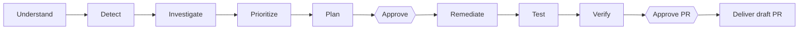

<div align="center">

# KYRO

**Think. Build. Secure.**

</div>

KYRO is a local-first, AI-assisted security remediation agent. It scans your repositories with real security tools, explains which findings matter, proposes a fix with a local model, applies it in a sandbox only after you approve, independently re-verifies the result, and prepares a draft GitHub pull request for human review.

> **Human in the loop, always.** You see the original scanner evidence, the proposed operation, the real diff and the verification results. Approval is required before any workspace edit and again before any pull request is published. KYRO never merges or deploys.

> **Status:** working local release for a single owner. It is not certified secure and is not ready for public or multi-tenant use. See [Project status](#project-status) for what has and has not been validated.

[Quick start](#quick-start) · [Try the demo](#try-the-demo-fixture) · [User guide](#user-guide) · [Configuration](#configuration) · [Project status](#project-status) · [Documentation](#documentation)

---

## How it works



| Stage | What happens |
|---|---|
| **Understand** | Retrieves an authorized source snapshot and indexes languages, frameworks, manifests, dependencies, entry points, tests and symbols. |
| **Detect** | Runs Semgrep, OSV-Scanner and Trivy in Docker, one after another, keeping each tool's output, exit status and errors. |
| **Investigate / Prioritize** | Normalizes findings, enriches them (OSV, NVD, FIRST EPSS, CISA KEV) and explains risk factors separately from raw CVSS. |
| **Plan** | A configured local model receives bounded, relevant code and returns a structured, reviewable plan. |
| **Approve** | You review every file, risk and command. Approval is bound to the plan, source commit and file hashes. |
| **Remediate / Test** | Approved edits run in an isolated Docker workspace with path, hash, command and resource limits. |
| **Verify** | A separate runner reruns build/tests and all scanners, then compares before and after. |
| **Deliver** | After a second approval, KYRO opens a **draft** PR, only if the result is `VERIFIED`. |

## Features

| Capability | Behavior |
|---|---|
| Projects and snapshots | Group repositories by project, choose a branch and inspect the exact commit retrieved. |
| Repository intelligence | Languages, frameworks, manifests, dependencies, entry points, test files and symbols (Python/JS/TS symbols; other languages get file and manifest indexing). |
| Real scanning | Semgrep, OSV-Scanner and Trivy with preserved provenance. |
| Unified findings | Search and filter normalized results while keeping the original scanner evidence. |
| Contextual prioritization | Risk factors plus reference/reachability evidence, with its limitations stated. |
| Evidence graph | Explore relationships among repositories, files and findings. |
| Local AI remediation | Bounded retrieval and structured plans from a local OpenAI-compatible model. |
| Controlled modification | Docker workspace; the sandbox never receives the Docker socket, credentials or host home directories. |
| Independent verification | Fresh build, test and rescan, with failed or incomplete outcomes retained. |
| Evidence reports | Downloadable JSON with finding, root cause, diff, command output, scan comparison and limitations. |
| Recovery and activity | Automatic retry of transient read failures, resumable indexing, job cancellation and persistent history. |
| Usage and analytics | Recorded tokens, inference time, scan history and outcomes. Unknown costs stay unknown. |

**Out of scope for the current release:** general-purpose bug fixing, full interprocedural dataflow analysis, and team permissions. These are future work, not current claims.

---

## Quick start

### Requirements

- Git
- Docker Desktop, or a Linux Docker engine 26+, with Compose 2.24.4+
- At least 10 GB free disk (images, scanner caches, source)
- A **local OpenAI-compatible model endpoint** for AI planning and editing. Scanning and repository analysis work without one.
- Internet access for the first build and for scanner databases. Offline use needs pre-populated scanner caches.

Host Python and Node are not needed for Docker deployment. For native development you also need Python 3.12–3.13, [uv](https://docs.astral.sh/uv/) and Node 24.

### 1. Start KYRO with Docker

**Windows (PowerShell)**

```powershell
git clone https://github.com/Gauravwakle96/KYRO.git
cd KYRO
if (-not (Test-Path -LiteralPath .env)) { Copy-Item .env.example .env }
./infrastructure/scripts/setup-scanners.ps1
docker compose up -d --build
```

**Linux / macOS**

```bash
git clone https://github.com/Gauravwakle96/KYRO.git
cd KYRO
[ -f .env ] || cp .env.example .env
docker pull semgrep/semgrep:1.184.0
docker pull ghcr.io/google/osv-scanner:v2.7.0
docker pull aquasec/trivy:0.76.2
docker build -t kyro-sandbox:local -f infrastructure/docker/Sandbox.Dockerfile .
docker compose up -d --build
```

### 2. Create your owner account

Open **http://127.0.0.1:8787** and create the first owner account (there is no preset password). Public registration closes after the first owner.

- Health check: http://127.0.0.1:8787/api/health
- API reference: http://127.0.0.1:8787/docs

### 3. Connect a model

AI remediation needs a running local model. See [Model configuration](#model-configuration). Check **AI Models** in the UI for availability.

### 4. Try it safely

Follow [Try the demo fixture](#try-the-demo-fixture) to exercise the whole workflow without any GitHub authorization.

<details>
<summary><strong>Run natively on Windows (without Docker for KYRO itself)</strong></summary>

```powershell
if (-not (Test-Path -LiteralPath .env)) { Copy-Item .env.example .env }
# Edit backend settings in .env. Never put credentials in source or frontend files.
./infrastructure/scripts/setup-scanners.ps1
./infrastructure/scripts/start-local.ps1
```

Open http://127.0.0.1:8787 and create the owner account. Stop with Ctrl+C. The script builds the frontend and runs the backend on loopback. For frontend development run `npm run dev` in `frontend` (its proxy targets port 8787).

Native paths are relative to `backend`: use `KYRO_DATA_DIR=../data` and `KYRO_DATABASE_URL=sqlite:///../data/kyro.db`. `.env` is read from the project root. Use absolute paths for custom deployments.

</details>

---

## Try the demo fixture

The fastest way to see KYRO work end to end. The fixture is **intentionally vulnerable** code, always labelled `TEST FIXTURE`. It cannot publish a PR. Never deploy it as an application.

1. Create a project.
2. Go to **Repositories** and click **Import test fixture**.
3. Click **Run scanners** and inspect the `eval` finding.
4. Create a model plan, review its files, risks and commands, then approve and execute.
5. Run independent verification and download the evidence report.

Real dependency findings in the fixture remain unless their own approved task addresses them. Fixture metrics must not be confused with production repository results.

---

## Configuration

### Model configuration

Defaults: `KYRO_LOCAL_ONLY=true`, `KYRO_LOCAL_MODEL_URL=http://127.0.0.1:8080/v1`, model `qwen3-8b`. Set the real model identifier in **AI Models**. KYRO does not download model weights or overwrite an existing inference installation.

Compatible providers must support JSON-schema structured completions, which remediation relies on.

**Ollama (existing install)** with `qwen2.5-coder:7b`, in the root `.env`:

```dotenv
KYRO_LOCAL_ONLY=true
KYRO_LOCAL_MODEL=qwen2.5-coder:7b
KYRO_LOCAL_MODEL_URL=http://127.0.0.1:11434/v1
KYRO_DEPLOY_LOCAL_MODEL_URL=http://host.docker.internal:11434/v1
```

The first URL is for native startup, the `DEPLOY` URL is for Docker. Use a model that is actually installed and running. After editing `.env`, run `docker compose up -d` to recreate changed services. On Linux and some Docker Desktop setups the model server must accept connections from Docker's host gateway (see [troubleshooting](docs/TROUBLESHOOTING.md)), and that endpoint should be restricted by interface or firewall.

**llama.cpp (`llama-server`)** with an existing Qwen3 GGUF:

```powershell
python tools/install_llama.py
./infrastructure/scripts/start-model.ps1 -ModelPath 'C:/path/to/your/Qwen3-8B-Q4_K_M.gguf'
```

The installer verifies GitHub asset SHA-256 digests and downloads binaries only. The launch script uses one 8192-token slot, quantized KV cache, automatic GPU fitting and a 1024-token reasoning ceiling, binds to loopback, and sleeps when idle. Avoid keeping another heavy model loaded at the same time.

**Optional cloud inference** is off by default. Local-only mode blocks external model URLs and never falls back to cloud. To enable it you need operator cost authorization, `KYRO_LOCAL_ONLY` disabled and backend provider configuration.

- `KYRO_CLOUD_PROTOCOL`: `chat` or `responses`
- `KYRO_MODEL_ROUTING`: local, cloud or automatic (automatic uses local for lower-severity dependency tasks and cloud for source-code or high-severity tasks)
- Plans record the selected provider and execution stays bound to it. Provider failures remain failures, and a server-configured ceiling bounds cloud attempts.
- Monetary estimates need verified operator-provided prices. Unavailable costs and tokens stay unavailable.
- Live cloud acceptance is currently blocked by the configured provider's client policy.

### GitHub connection

| Method | Notes |
|---|---|
| **GitHub App** (preferred) | Restrict to selected repositories with **Metadata: read**, **Contents: read/write**, **Pull requests: read/write**. Set `KYRO_GITHUB_APP_ID`, `KYRO_GITHUB_INSTALLATION_ID`, `KYRO_GITHUB_APP_PRIVATE_KEY_PATH`. Keep the private key outside the checkout and install the App only on repositories KYRO may modify. |
| **OAuth device flow** | Set `KYRO_GITHUB_CLIENT_ID` with device flow enabled. Credentials are encrypted in the backend data directory. The `repo` scope is broader than a restricted App. |
| **Fine-grained PAT** | Set `KYRO_GITHUB_TOKEN` on the backend with selected-repository Contents and PR permissions. Never place it in frontend config or source. |

PR creation requires a `VERIFIED` report plus explicit approval. KYRO creates a **draft**, never merges, and refuses if the base SHA changed.

**Current import behavior:** GitHub authorization is required, and the UI lists repositories available to that connection. Importing a public repository by URL without a token is planned but not implemented. Fork-based delivery to repositories you do not control is also pending. A link alone never grants write access.

### Settings reference

| Setting | Default | Purpose |
|---|---|---|
| `KYRO_LOCAL_ONLY` | `true` | Block external model URLs and cloud fallback |
| `KYRO_LOCAL_MODEL` | `qwen3-8b` | Local model identifier |
| `KYRO_LOCAL_MODEL_URL` | `http://127.0.0.1:8080/v1` | Model endpoint for native startup |
| `KYRO_DEPLOY_LOCAL_MODEL_URL` | none | Model endpoint as seen from the Docker container |
| `KYRO_AUTOMATIC_RECOVERY` | `true` | Retry eligible transient read failures |
| `KYRO_JOB_MAX_ATTEMPTS` | `3` | Total attempts per eligible job |
| `KYRO_JOB_RETRY_DELAY` | `2` seconds | Base retry delay |
| `KYRO_DATA_DIR` / `KYRO_DATABASE_URL` | see above | Data location and database |

---

## User guide

1. **Check setup.** Open **Workspace setup** to see GitHub, scanner and model readiness. Missing integrations are reported explicitly.
2. **Create a project.** **Projects** → name, optional description → **Create project**.
3. **Connect a repository.** **Repositories** → choose project, GitHub repository and branch → **Connect**. Watch **Agent Workspace** until it is `READY`.
4. **Inspect it.** Browse source, languages, frameworks, discovered tests and symbols. A stored snapshot does not silently follow later remote commits; **Analyze** re-indexes the stored snapshot.
5. **Run scanners.** Click **Run scanners**. Check **Security** and the execution timeline for completed, partial or errored runs.
6. **Investigate a finding.** In **Findings**, review location, version, scanner evidence, risk factors and reachability. **Enrich finding** queues advisory lookups where identifiers exist.
7. **Request a plan.** **Create remediation plan**. The model proposes root cause, strategy, risks, existing files and build/test commands. These are proposals, not test results.
8. **Review and approve.** Inspect every file and command, tick **I reviewed the changes, risks and commands**, click **Approve plan**, then **Execute approved fix**. Execution changes a separate managed Docker workspace, never the remote branch.
9. **Follow execution.** Watch model and tool actions, checkpoints, diff, output and errors. Bounded revisions may address failed patch validation or tests within the approved scope; an exhausted agent stays failed.
10. **Verify.** **Run independent verification** reruns approved commands and scanners in a separate runner and checks scope.
11. **Download evidence.** **Download evidence report** gives the original finding, root cause, changed files, diff, build/test output, independent scans, before/after comparison and limitations.
12. **Deliver.** A `VERIFIED` real-repository task shows **Create draft pull request**. It needs separate approval and authorized write access, and a PR is reported only after GitHub confirms creation.

**Tip:** for an unfamiliar repository, start with one finding and a small reviewed patch. Missing project dependencies may require a trusted custom sandbox image before tests are meaningful. A repository with no discovered tests must never be presented as having passed tests.

### Verification outcomes

| Outcome | Meaning |
|---|---|
| `VERIFIED` | The selected finding resolved under complete baseline/rescan coverage, scope checks passed and build/test succeeded. This is **not** proof of complete application security. |
| `PARTIALLY_VERIFIED` | Some evidence supports the fix, but tests, build or scanner coverage are incomplete. |
| `FAILED` | The issue remains, a quality gate or tests fail, scope changed unexpectedly, or new findings appeared. |
| `INCONCLUSIVE` | Required evidence or a complete baseline is unavailable. |

### Reading findings correctly

- Static imports and call references do not prove runtime exploitability.
- `NO_REFERENCE_FOUND` does not mean safe.
- `NOT_APPLICABLE` means a tool found no supported dependency input. `PARTIAL` means incomplete analysis. Both keep missing coverage visible.
- Zero findings is not a security certification.

### Where things live in the UI

| Area | Use it for |
|---|---|
| Overview | Real repository, finding, scan and remediation counts |
| Projects / Repositories | Project management, branch selection, snapshots, source browsing |
| Security / Findings / Dependencies | Scanner runs, evidence-backed review, dependency inventories |
| Evidence graph | Relationships among repositories, files and findings |
| Remediation / Agent Workspace | Plans, approvals, diffs, actions, jobs, recovery history |
| Verification / Pull Requests | Independent results, reports, confirmed draft PRs |
| Analytics / AI Models / Settings | Usage history, model availability, runtime and audit policy |

---

## Automatic recovery

Enabled by default for imports, fixture retrieval, indexing, baseline scans and enrichment. Temporary network or provider failures retry, and interrupted read jobs resume after a backend restart. Attempts, original failure reasons, delays and outcomes persist in jobs and audit records.

**Default policy:** three total attempts, delays of 2 and 4 seconds, provider `Retry-After` capped at 60 seconds, original job deadline preserved. Cancellation stops recovery. Manual retry preserves the original failed job and its evidence.

Recovery **cannot** create missing source, grant permissions, turn failing tests into passing ones, or fix arbitrary product bugs. Interrupted agent edits, verification and GitHub delivery are **not** replayed automatically. KYRO never rewrites itself, exposes credentials, widens sandbox permissions, merges or deploys as a recovery step. Details and fault-injection evidence: [AUTOMATIC_RECOVERY.md](docs/AUTOMATIC_RECOVERY.md).

---

## Deployment and security

```powershell
./infrastructure/scripts/setup-scanners.ps1
docker compose build
docker compose up -d
```

- Compose exposes **loopback only** by default.
- SQLite and source live in the `kyro-data` volume. For PostgreSQL, set a secret `POSTGRES_PASSWORD` in `.env` and run `docker compose -f docker-compose.yml -f docker-compose.postgres.yml up -d --build`.
- Stop with `docker compose stop`. View logs with `docker compose logs --tail 100 kyro`.
- Do **not** run `docker compose down -v` unless you intend to delete stored data.

> **Deployment boundary:** the backend's Docker socket grants control of the Docker host. Repository execution containers never receive that socket, credentials or host home directories. Use a dedicated Docker host or VM and restrict KYRO to trusted operators. Read [sandbox security](docs/SANDBOX_SECURITY.md) and the [deployment guide](docs/DEPLOYMENT_GUIDE.md) before broader use. Public deployment needs separate authorization and hardening.

Findings and logs can contain sensitive repository information. The data volume holds snapshots, findings, reports, caches and encrypted OAuth credentials. Protect it, and back it up together with the encryption key. Never publish runtime data with the source. Do not run concurrent replicas with SQLite or the single-worker dispatcher.

---

## Project status

Recorded validation on **2026-11-07**:

**Passing**
- 132 backend tests, 9 frontend unit tests and 14 deployed browser tests (three responsive/accessibility viewports and retained recovery history).
- Python lint and type checks, frontend lint, type check and production build, and Node/Python dependency audits.
- A fresh deployed fixture run with real local-model planning, explicit approval, Docker modification, build and four tests, and all three independent rescans: **`VERIFIED`, 22 → 21 findings, zero new findings**. Six extra security regression tests and sandbox boundary/timeout probes also passed.
- Indexing interrupted by an abrupt container restart finished the **same job on attempt 2**, indexing 1,504 fixture files with no manual retry.
- All **19 authorized repositories** processed sequentially: 17 indexed, 8 complete scanner runs, 9 inconclusive runs, 2 empty repositories, **347 normalized findings**. This does not establish that every repository's builds, tests or fixes passed.
- On a real repository, the local model produced a reviewable plan and OSV/NVD/EPSS/KEV enrichment returned recorded sources. That repository had no discovered tests, and its plan still required dependency compatibility review.

**Still pending**
- Live GitHub App/OAuth acceptance
- A product-generated draft PR on GitHub
- Successful live cloud inference
- Public or team deployment

Earlier measured backend coverage was 69.87%. No updated figure is claimed. Exact scope, evidence and failures are in the [test execution report](docs/TEST_EXECUTION_REPORT.md), [repository validation report](docs/REPOSITORY_VALIDATION_REPORT.md), [product checklist](docs/PRODUCT_CHECKLIST.md) and [implementation status](IMPLEMENTATION_STATUS.md). Publishing this source repository is separate from testing KYRO's PR engine.

## Scope and limitations

- Initial Semgrep scope is seven local rules: dynamic evaluation/execution, pickle, shell calls and unsafe YAML.
- OSV and Trivy provide advisory-backed dependency coverage. Missing supported inputs report `NOT_APPLICABLE`.
- Static reachability is conservative, and no runtime exploit claim is made.
- The default sandbox includes Python, pytest, Node and npm. Framework dependencies, Go and Rust need a trusted custom sandbox image.
- Dependency installation inside untrusted scripts has no network access by default.
- Single local owner and one lightweight background worker.

---

## Architecture

KYRO is a modular monolith: React/TypeScript/Vite frontend, FastAPI/Pydantic backend, SQLAlchemy/Alembic persistence, a database-backed job worker, independent scanner adapters, a local/optional-cloud model router and a Docker sandbox. SQLite is the default and a PostgreSQL overlay is provided. No Redis, graph database, paid model provider or multi-agent cluster is required.

```text
frontend/             Web UI, API client, browser and unit tests
backend/app/          API, database, scanners, intelligence, agent, sandbox, verification
backend/migrations/   Alembic migrations
infrastructure/       Docker images, Compose overlays, startup scripts
tests/fixtures/       Labelled vulnerable test source
tools/                Research, audit, acceptance and packaging harnesses
docs/                 Architecture, threat model, guides and recorded evidence
```

## Development

```powershell
cd backend
uv sync --frozen
uv run pytest --cov=app
uv run ruff check app migrations
uv run mypy app
uvx pip-audit -r requirements.txt

cd ../frontend
npm ci
npm run typecheck
npm run lint
npm run test
npm audit
npm run build
```

`tools/live_acceptance.py` tests only the labelled fixture on an isolated server at port 8788 (see [benchmarking](docs/BENCHMARKING_FRAMEWORK.md)). Run browser acceptance with `npm run test:e2e` after that setup. Fixtures are kept separate from live evidence under `docs/evidence/`.

## Documentation

| Topic | Documents |
|---|---|
| Status | [Product checklist](docs/PRODUCT_CHECKLIST.md), [Implementation status](IMPLEMENTATION_STATUS.md) |
| Design | [Architecture](docs/PRODUCT_ARCHITECTURE.md), [System design](docs/SYSTEM_DESIGN.md), [Database schema](docs/DATABASE_SCHEMA.md), [API](docs/API_DOCUMENTATION.md) |
| Analysis | [Repository intelligence](docs/REPOSITORY_INTELLIGENCE.md), [Reachability](docs/REACHABILITY_ANALYSIS.md), [Evidence graph](docs/ATTACK_PATH_ARCHITECTURE.md), [Vulnerability intelligence](docs/VULNERABILITY_INTELLIGENCE.md) |
| Agent | [Reliability](docs/AGENT_RELIABILITY.md), [Patch quality](docs/PATCH_QUALITY.md), [Verification](docs/VERIFICATION_ENGINE.md), [Recovery](docs/AUTOMATIC_RECOVERY.md) |
| Security | [Threat model](docs/THREAT_MODEL.md), [Sandbox](docs/SANDBOX_SECURITY.md), [Data isolation](docs/DATA_ISOLATION.md) |
| Operations | [Deployment](docs/DEPLOYMENT_GUIDE.md), [Troubleshooting](docs/TROUBLESHOOTING.md), [CI/CD](docs/CI_CD_INTEGRATION.md) |
| Evidence | [Test execution report](docs/TEST_EXECUTION_REPORT.md), [Repository audit](docs/REPOSITORY_VALIDATION_REPORT.md), [Benchmarking](docs/BENCHMARKING_FRAMEWORK.md) |

## Maintainer

<div align="center">


</div>

## License

KYRO's original source is available under the [MIT License](LICENSE). Integrated scanners, models, dependencies and bundled third-party assets keep their own licenses. Review them for your deployment and redistribution.
